<p align="center">
  <picture>
    <source media="(prefers-color-scheme: dark)" srcset="src/assets/hardwario-tower-reversed.svg">
    
  </picture>
</p>

<h1 align="center">TOWER Bridge</h1>

<p align="center">
  Live readings, charts and alerts from HARDWARIO TOWER modules,<br>
  right in your menu bar or system tray.
</p>

<p align="center">
  <a href="https://github.com/hardwario/tower-bridge/actions/workflows/ci.yml"></a>
  <a href="https://github.com/hardwario/tower-bridge/releases/latest"></a>
  <a href="LICENSE"></a>
</p>

<p align="center">
  <a href="https://github.com/hardwario/tower-bridge/releases/latest"><b>Download</b></a> ·
  <a href="docs/manual/en.md">User manual</a> ·
  <a href="docs/cli.md">Command line</a> ·
  <a href="docs/mqtt.md">MQTT</a> ·
  <a href="docs/api.md">REST API and MCP</a>
</p>

<picture>
  <source media="(prefers-color-scheme: dark)" srcset="docs/manual/images/en/dashboard.dark.webp">
  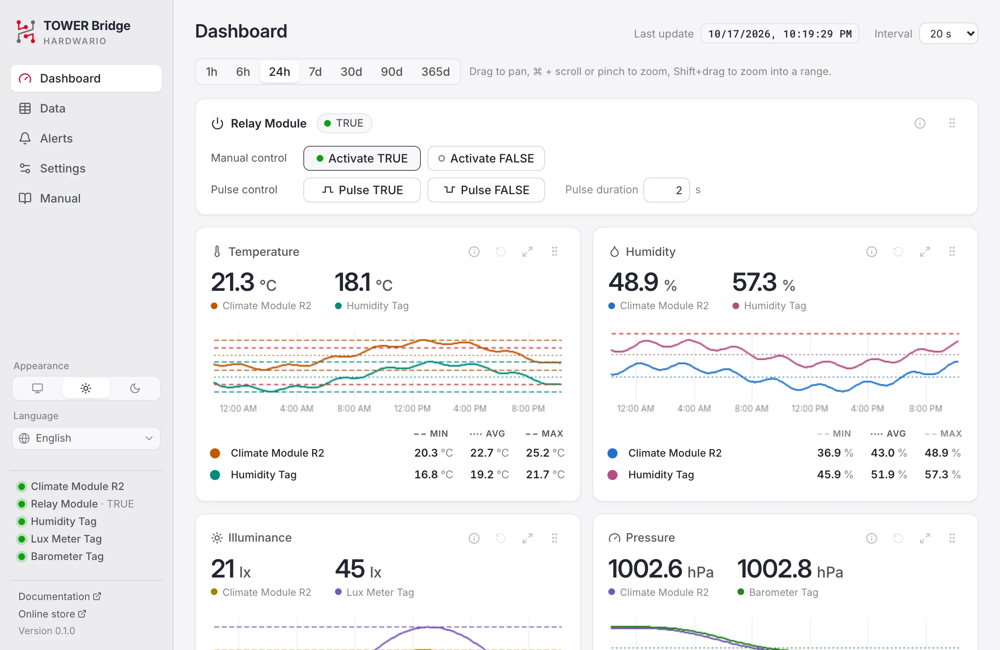
</picture>

## What it does

TOWER Bridge is a desktop app for the HARDWARIO **TOWER Bridge Module**. Put
TOWER modules on the bridge, plug it into your computer, and the app:

- shows the current value in the menu bar or tray, and every reading in its menu;
- records the history and draws interactive charts;
- notifies you when a value leaves its range;
- switches a relay, shows a GPS position on a map and writes a URL to an NFC tag;
- shares the readings over MQTT, a REST API, Prometheus metrics and MCP.

It runs on Windows, macOS and Linux. `tower-bridge-cli`, its headless sibling,
does the same in a terminal or as a service on a Raspberry Pi. TOWER Bridge
continues [hardwario/enmon](https://github.com/hardwario/enmon), the
command-line reader for the same hardware.

## Hardware

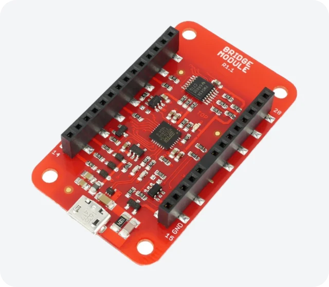

The [TOWER Bridge Module](https://docs.hardwario.com/tower/hardware-modules/about-bridge-module/)
connects TOWER modules to a computer over USB. It is an FTDI FT260 USB to I²C
bridge with an I²C switch, so it has two channels: put a Climate Module on one
and sensor tags on the other, or anything on both.

The app finds the modules by itself, names them from the parts it detects, and
looks again every minute, so a tag plugged in later shows up on its own.

Windows and macOS need no driver. On Linux, install the udev rule (see
[First run](#first-run)).

<br clear="right">

<table>
  <tr>
    <td align="center" valign="top" width="25%"><a href="https://docs.hardwario.com/tower/hardware-modules/about-climate-module/">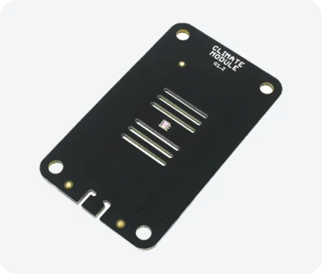</a><br><b>Climate Module</b><br><sub>temperature, humidity, illuminance, pressure</sub></td>
    <td align="center" valign="top" width="25%"><a href="https://docs.hardwario.com/tower/hardware-modules/about-co2-module/">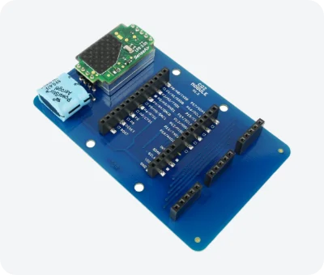</a><br><b>CO2 Module</b><br><sub>CO₂, pressure compensated</sub></td>
    <td align="center" valign="top" width="25%"><a href="https://docs.hardwario.com/tower/hardware-modules/about-relay-module/">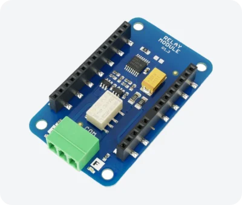</a><br><b>Relay Module</b><br><sub>switch or pulse a load</sub></td>
    <td align="center" valign="top" width="25%"><a href="https://docs.hardwario.com/tower/hardware-modules/about-gps-module/">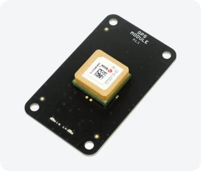</a><br><b>GPS Module</b><br><sub>position, altitude, satellites</sub></td>
  </tr>
  <tr>
    <td align="center" valign="top"><a href="https://docs.hardwario.com/tower/hardware-modules/about-humidity-tag/">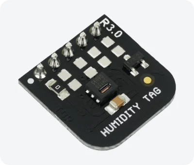</a><br><b>Humidity Tag</b><br><sub>humidity, temperature</sub></td>
    <td align="center" valign="top"><a href="https://docs.hardwario.com/tower/hardware-modules/about-temperature-tag/">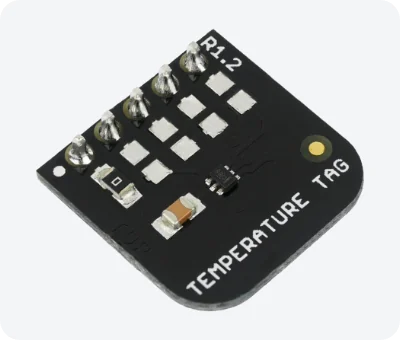</a><br><b>Temperature Tag</b><br><sub>temperature</sub></td>
    <td align="center" valign="top"><a href="https://docs.hardwario.com/tower/hardware-modules/about-lux-meter-tag/">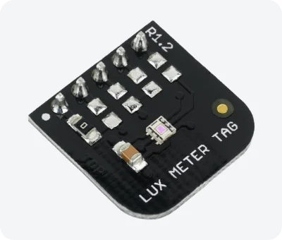</a><br><b>Lux Meter Tag</b><br><sub>illuminance</sub></td>
    <td align="center" valign="top"><a href="https://docs.hardwario.com/tower/hardware-modules/about-barometer-tag/">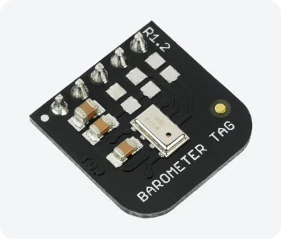</a><br><b>Barometer Tag</b><br><sub>pressure, altitude</sub></td>
  </tr>
</table>

Also supported: the **TOWER VOC-LP Tag** (TVOC, humidity compensated) and the
**TOWER NFC Tag** (a URL that phones open when they touch it).

## Features

### Dashboard and charts

A panel per quantity with a line per module, the latest values in large type,
and a chart of the chosen span.

- 1 h to 365 days, or drag to pan through everything stored
- Ctrl/⌘+scroll, pinch or Shift+drag to zoom; the exact value and time under the pointer
- min, average and max as numbers and optional lines, alert limits as light red bands
- panels rearranged by dragging and maximized with a click; colors from an 8-color palette

<picture>
  <source media="(prefers-color-scheme: dark)" srcset="docs/manual/images/en/chart.dark.webp">
  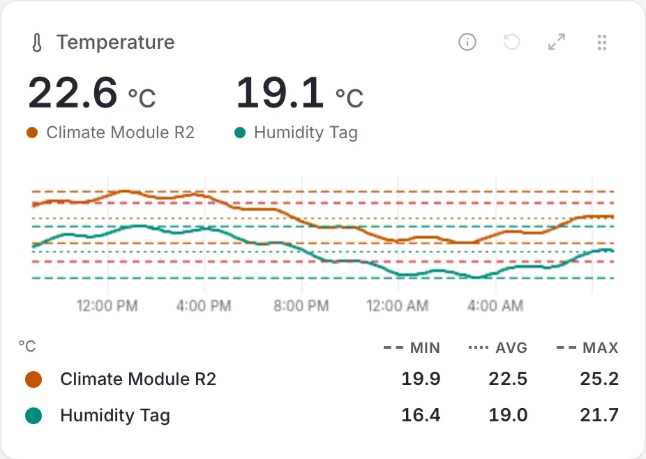
</picture>

### Relay, GPS and NFC

- **Relay Module:** switch it to TRUE or FALSE, or pulse it for a set time, from
  the dashboard, REST, MCP or MQTT
- **GPS Module:** fix, position on an offline map (with a link to
  OpenStreetMap), altitude and satellites
- **NFC Tag:** write a URL (an NDEF URI record) that phones open when they touch the tag

<picture>
  <source media="(prefers-color-scheme: dark)" srcset="docs/manual/images/en/relay.dark.webp">
  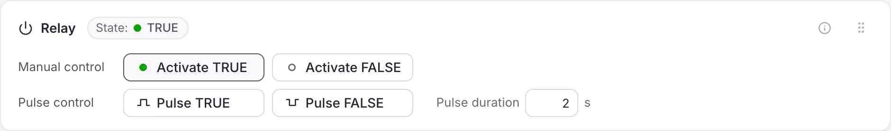
</picture>

<picture>
  <source media="(prefers-color-scheme: dark)" srcset="docs/manual/images/en/gps.dark.webp">
  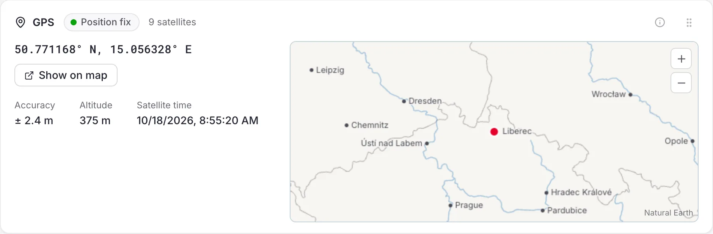
</picture>

### Alerts

A notification when a value leaves its range, with hysteresis so a value
hovering at the limit does not flood you, a repeat interval, and an optional
note when it is back to normal. Another one when the bridge is disconnected.

<picture>
  <source media="(prefers-color-scheme: dark)" srcset="docs/manual/images/en/alerts.dark.webp">
  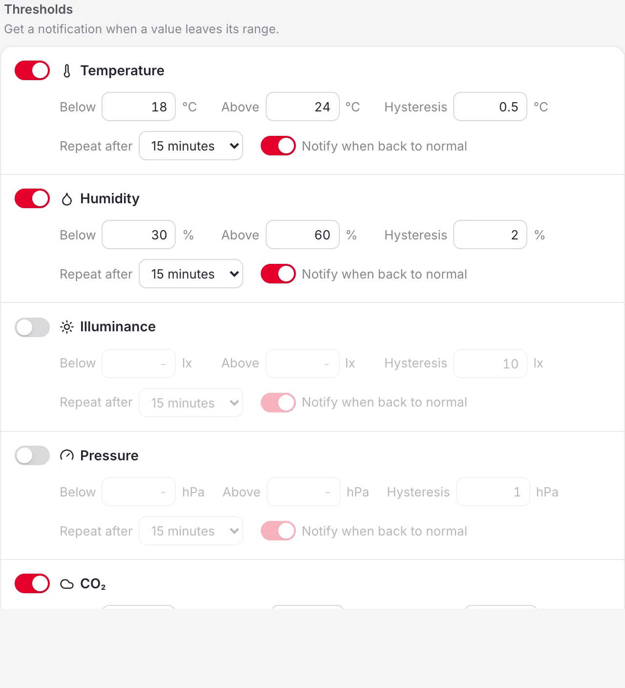
</picture>

### History and export

Every reading is stored in SQLite (90 days by default) in the data folder shown
in *Settings → Data*. The Data page shows it as a table, over a span or a custom
range, and exports it as CSV or XLSX.

<picture>
  <source media="(prefers-color-scheme: dark)" srcset="docs/manual/images/en/data.dark.webp">
  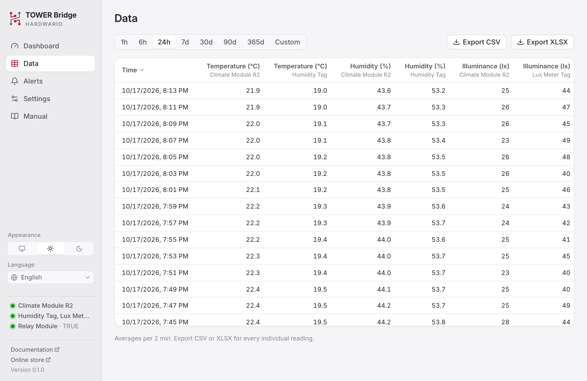
</picture>

### MQTT, REST, Prometheus and MCP

All optional and off by default:

- **MQTT** to your own broker (Mosquitto, Home Assistant): every reading with
  its I²C channel, relay commands, and the app's availability ([docs/mqtt.md](docs/mqtt.md))

  ```text
  $ mosquitto_sub -h broker.local -t 'tower/#' -v
  tower/status online
  tower/temperature/0 23.46
  tower/humidity/0 45.2
  tower/co2/0 612
  ```

- **REST API** and **Prometheus metrics** for scripts and Grafana, and an
  **MCP server** so AI assistants (Claude, Cursor, VS Code) can read the sensors
  ([docs/api.md](docs/api.md))

  ```sh
  claude mcp add --transport http tower-bridge http://127.0.0.1:8180/mcp
  ```

### Command line

`tower-bridge-cli` shares the app's settings and history. It has a terminal
dashboard, commands for scripts (text or JSON), and a service without a window
for a Raspberry Pi or a server ([docs/cli.md](docs/cli.md)).

<picture>
  <source media="(prefers-color-scheme: dark)" srcset="docs/images/cli-dashboard.dark.webp">
  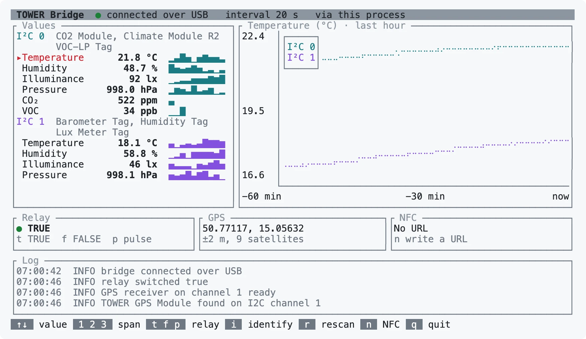
</picture>

```sh
tower-bridge-cli                         # the dashboard (in a terminal)
tower-bridge-cli status                  # the bridge, its modules and the latest values
tower-bridge-cli --json watch | jq .     # a line per reading, as NDJSON
tower-bridge-cli relay pulse --ms 3000   # TRUE or FALSE for 3 s, then back
tower-bridge-cli export --last 7d -o week.xlsx
tower-bridge-cli run                     # the service: history, alerts, MQTT, API
```

### And also

- Open at login
- Light or dark theme, or follow the system; date and 12/24-hour time format
- English, Čeština, Slovenčina, Deutsch and Polski (follows the system language
  by default), including the tray menu and notifications
- One file per platform, no installer on Windows
- The user manual is built in: open *Manual* in the sidebar

## Download

Get the [latest release](https://github.com/hardwario/tower-bridge/releases/latest):

| Platform | File |
|---|---|
| Windows 10/11 (x64) | `tower-bridge-<version>-windows-x64-portable.exe` |
| macOS 11+ with Safari 16.2+ (Apple silicon and Intel) | `tower-bridge-<version>-macos-universal.dmg` |
| Linux (x86_64) | `tower-bridge-<version>-linux-x86_64.AppImage` |
| Command line, every platform (Linux also on 64-bit ARM) | `tower-bridge-cli-<version>-<target>.tar.gz` (`.zip` on Windows), see [docs/cli.md](docs/cli.md) |

### First run

<details>
<summary><b>Windows</b></summary>

Run the exe; no installation needed.

- The dashboard needs the Microsoft Edge WebView2 Runtime, which ships with
  Windows 11 and current Windows 10.
- The exe is signed by HARDWARIO a.s. While a new release is still unknown to
  SmartScreen it may warn: choose *More info → Run anyway*.
- Windows 11 may hide new tray icons in the overflow area; drag the icon to the
  taskbar to keep it visible.

**Portable mode:** create a folder named `data` next to the exe. Settings,
history and logs are then stored there instead of `%LOCALAPPDATA%`, so the app
can run from a USB stick. The only thing written outside is a registry key that
lets Windows show notifications
(`HKCU\Software\Classes\AppUserModelId\com.hardwario.tower-bridge`).

</details>

<details>
<summary><b>macOS</b></summary>

Open the dmg and drag *TOWER Bridge* to *Applications* (Open at Login requires
the app to be in Applications).

- The app is signed by HARDWARIO and notarized by Apple, so it opens without
  warnings.
- At its first start it asks for permission to send notifications (alerts and
  the test in Alerts need it).
- The window is drawn by the system's WebKit, so keep Safari updated (16.2 or
  newer; Software Update offers it for macOS 11 too).

</details>

<details>
<summary><b>Linux</b></summary>

Install the udev rule (`70-hardwario-tower-bridge.rules`, a release asset, also
in `packaging/linux/`) so your user can open the bridge:

```sh
sudo cp 70-hardwario-tower-bridge.rules /etc/udev/rules.d/
sudo udevadm control --reload && sudo udevadm trigger
```

Then see [docs/linux.md](docs/linux.md) for the kernel driver notes and the
GNOME tray extension.

</details>

### Good to know

- The menu bar or tray shows the value chosen in *Settings → Value in menu bar*.
  Click the icon for all readings and quick toggles; on Windows a left click
  opens the dashboard.
- Closing the dashboard keeps the app running in the tray. Quit from the tray
  menu.
- Without a desktop, `tower-bridge-cli run` does what the app does. Only one of
  them runs per data folder; other commands then go through its API server.
- The manual's source, in all five languages, is in [docs/manual](docs/manual/en.md).

## Building from source

Requirements: Rust 1.99+, Node.js 22+, and the
[Tauri prerequisites](https://v2.tauri.app/start/prerequisites/) for your OS
(on Linux: `libwebkit2gtk-4.1-dev libayatana-appindicator3-dev librsvg2-dev
libudev-dev`).

```sh
npm ci
npm run tauri dev                         # run with hot reload
TOWER_BRIDGE_SIMULATE=1 npm run tauri dev # no hardware: a simulated bridge with every module
npm run tauri build                       # release bundles (dmg / AppImage)
npm run tauri build -- --no-bundle        # Windows portable exe
```

A debug binary started directly (`cargo run -p tower-bridge`) loads the
dashboard from the Vite dev server at `localhost:1420` and shows a blank window
without it. Use `npm run tauri dev`, or embed the dashboard:
`npm run build && cargo run -p tower-bridge --features tauri/custom-protocol`.

`npm run dev` and opening `http://localhost:1420/preview.html` runs the
dashboard in a browser against a mocked backend.

<details>
<summary><b>Development helpers</b></summary>

| Variable | Effect |
|---|---|
| `TOWER_BRIDGE_SIMULATE=1` (or `--simulate`) | Use a simulated bridge; data goes to a separate `simulated` folder. Runs alongside an installed copy (no single-instance check) |
| `TOWER_BRIDGE_SEED_DAYS=14` | With simulation, fill an empty history with generated data |
| `TOWER_BRIDGE_DATA_DIR=/path` | Override the data folder (also skips the single-instance check) |
| `TOWER_BRIDGE_LOG=debug` | Log level (logs also go to the data folder) |

`npm run manual:screenshots` regenerates the screenshots of the user manual
(also used in this README) from the browser preview, in every language and
theme (needs Google Chrome). `npm run cli:screenshot` regenerates the one of the
CLI dashboard on the simulated bridge (needs Python 3 and Google Chrome).

Translations: the dashboard dictionaries are `src/lib/i18n/{en,cs,sk,de,pl}.ts`
(English is the reference; the others are type-checked against it). Tray
menu, notification and dialog texts are in `src-tauri/src/i18n.rs`.

</details>

<details>
<summary><b>Tests and checks</b></summary>

```sh
cargo fmt --all --check
cargo clippy --workspace --all-targets --all-features -- -D warnings
cargo test --workspace --all-features
npm run check && npm test
npm run test:ui          # browser smoke test of every view (needs Google Chrome)
npm run test:ui:webkit   # the same in WebKit (npx playwright-core install webkit)
npm run notices -- --check
npm run build
```

</details>

Releases are built, signed and drafted by GitHub Actions from a version tag:
see [docs/release.md](docs/release.md).

## Project layout

| Path | Contents |
|---|---|
| `crates/tower-bridge-core` | FT260 transport (hidapi, Linux i2c-dev), sensor drivers, sensor detection on both I²C channels, acquisition thread, alert engine, SQLite store, MQTT client, REST/MCP server |
| `crates/tower-bridge-service` | The service the app and the CLI share: data folder and settings, the hub (storage, alerts, MQTT), commands to the bridge, the API server; one instance per data folder |
| `crates/tower-bridge-cli` | `tower-bridge-cli`: terminal dashboard, commands, the service without a window (`run`), MCP bridge, and the bring-up `toolbox` |
| `src-tauri` | Desktop app: tray, dashboard window, notifications, Tauri commands |
| `src` | Dashboard UI (Svelte 5, uPlot); translations in `src/lib/i18n/` |
| `docs` | [Command line](docs/cli.md), [Hardware protocol](docs/hardware.md), [Linux](docs/linux.md), [MQTT](docs/mqtt.md), [REST API & MCP](docs/api.md), [user manual](docs/manual/en.md) |
| `packaging/linux` | udev rule |

## Contributing

Read [AGENTS.md](AGENTS.md) first: architecture, commands, conventions and
lessons learned, for people and coding agents alike. Work in progress is listed
in [TODO.md](TODO.md).

## License

MIT, © 2026 HARDWARIO a.s. See [LICENSE](LICENSE).

The MIT license covers the source code. The HARDWARIO and TOWER names and the
HARDWARIO logo are trademarks of HARDWARIO a.s. and are not licensed for use in
derived products.

Third-party components include [Tauri](https://tauri.app) (MIT/Apache-2.0),
[hidapi](https://github.com/libusb/hidapi) (BSD-3-Clause),
[rumqttc](https://github.com/bytebeamio/rumqtt) (Apache-2.0),
[axum](https://github.com/tokio-rs/axum) (MIT),
[SQLite](https://sqlite.org) (public domain), [uPlot](https://github.com/leeoniya/uPlot)
(MIT), [Svelte](https://svelte.dev) (MIT), icons from
[Lucide](https://lucide.dev) (ISC), the [Inter](https://rsms.me/inter/) and
[Roboto Mono](https://github.com/googlefonts/RobotoMono) fonts (SIL OFL 1.1,
`src/assets/fonts/OFL-*.txt`), the Barlow Condensed font (SIL OFL 1.1,
`src-tauri/assets/fonts/OFL.txt`), and map data from
[Natural Earth](https://www.naturalearthdata.com) (public domain) via
[world-atlas](https://github.com/topojson/world-atlas) (ISC) with place names
from [Wikidata](https://www.wikidata.org) (CC0).

[THIRD-PARTY-NOTICES.md](THIRD-PARTY-NOTICES.md) lists every crate, npm package,
font, icon set and map source in the app with its license text; the app shows it
from the About chapter of the Manual. Regenerate it with `npm run notices` after
a dependency change (CI fails when it is out of date).
