# Návod k aplikaci TOWER Bridge

TOWER Bridge zobrazuje hodnoty z modulu HARDWARIO TOWER Climate Module a senzorových tagů TOWER připojených přes TOWER Bridge Module, ukládá jejich historii a ovládá TOWER Relay Module. Návod popisuje verzi {version}.

## Úvod {#introduction}

Potřebujete:

- **TOWER Bridge Module** připojený k počítači přes USB.
- **TOWER Climate Module** (revize R1 nebo R2) pro teplotu, relativní vlhkost, osvětlení a atmosférický tlak.
- Volitelně senzorové tagy TOWER: **Humidity Tag**, **Temperature Tag**, **Lux Meter Tag** a **Barometer Tag**, samostatně nebo vedle Climate Module.
- Volitelně **TOWER Relay Module**, bistabilní relé, které ovládáte z aplikace.
- Volitelně **TOWER NFC Tag**, který telefonu, jenž se ho dotkne, předá webovou adresu podle vaší volby.
- Volitelně **TOWER CO2 Module** (oxid uhličitý), **VOC-LP Tag** (těkavé organické látky) a **TOWER GPS Module** (poloha).

Aplikace běží v řádku nabídek (macOS) nebo v oznamovací oblasti (Windows, Linux). Měří i se zavřeným oknem.

## První kroky {#getting-started}

### Instalace {#install}

- **macOS:** otevřete soubor DMG a přetáhněte TOWER Bridge do složky Aplikace.
- **Windows:** spusťte soubor EXE. Instalace není potřeba; okno používá WebView2, který je součástí Windows 11.
- **Linux:** nastavte souboru AppImage právo ke spuštění a spusťte ho. Nainstalujte pravidlo udev z projektu, aby aplikace mohla otevřít zařízení bez práv správce.

### Připojení hardwaru {#connect}

Zasuňte Climate Module, případně i Relay Module, do Bridge Module a připojte ho přes USB. Aplikace moduly najde během několika sekund. Když moduly vyměníte za běhu aplikace, stiskněte na Nástěnce **Hledat znovu**.

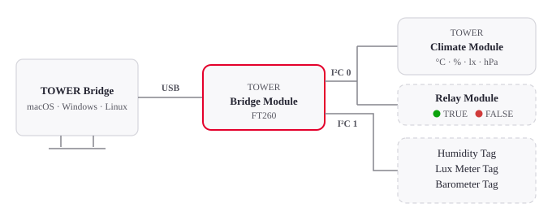

Relay Module a tagy jsou volitelné, proto mají přerušovaný obrys.

Bridge Module má dva kanály I²C a senzory mohou být na obou, například Climate Module uvnitř na kanálu 0 a tagy venku na kanálu 1. Aplikace hledá na obou kanálech a tag připojený za běhu najde do minuty.

### Řádek nabídek a oznamovací oblast {#tray}

Ikona ukazuje aktuální hodnotu veličiny zvolené v nastavení. Její nabídka otevírá nástěnku, vypisuje všechny hodnoty a stav připojení, zapíná a vypíná **Spouštět po přihlášení** a MQTT a ukončuje aplikaci. Zavřením okna nástěnky aplikace běží dál. Když se veličina měří na obou kanálech, nabídka ukazuje obě hodnoty, kanál 0 první.

## Nástěnka {#dashboard}

Nástěnka ukazuje Relay Module, poslední hodnotu každé veličiny s grafem a TOWER Bridge Module. **Poslední aktualizace** nahoře říká, kdy proběhlo poslední měření. Vedle ní **Interval** určuje, jak často se senzory měří, od 5 sekund do 3 minut (ve výchozím stavu 20 sekund).

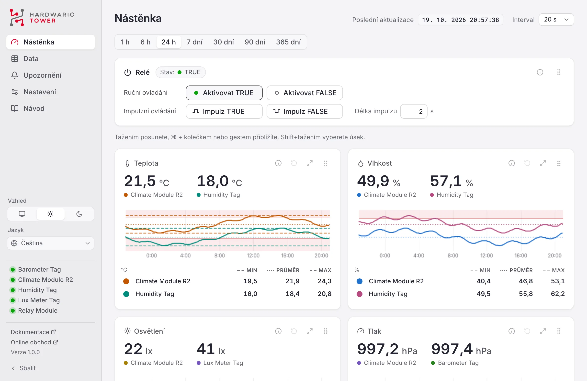

### Grafy {#charts}

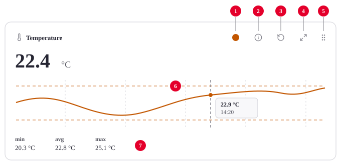

1. **Barva:** vybírá barvu čáry.
2. **Zdroj dat:** najeďte na ikonu ⓘ a uvidíte modul, kanál I²C, adresu a senzor, ze kterého hodnoty pocházejí.
3. **Obnovení:** vrátí zvolené časové období.
4. **Maximalizace:** zvětší graf; dalším stisknutím nebo klávesou <kbd>Esc</kbd> ho vrátíte.
5. **Přesun:** přetáhněte panel na nové místo; pořadí se zapamatuje.
6. **Graf:** najeďte na něj a uvidíte přesnou hodnotu a čas.
7. **Min, průměr, max:** pro zobrazený úsek. Kliknutím zobrazíte nebo skryjete jejich čáru v grafu.

Časové období vyberte nad grafy, od 1 hodiny do 365 dní. Všechny grafy na stránce se posouvají společně.

| Akce | Jak na to |
|---|---|
| Posun | Táhněte graf doleva nebo doprava |
| Přiblížení | <kbd>Ctrl</kbd> + kolečko (na macOS <kbd>⌘</kbd> + kolečko), nebo gesto na touchpadu |
| Přiblížení úseku | <kbd>Shift</kbd> + tažení |
| Návrat na časové období | Ikona obnovení (4) |

Červený okraj nahoře na panelu znamená, že hodnota je mimo limity upozornění; přerušovaná červená čára v grafu ukazuje limit.

Když se stejná veličina měří na obou kanálech, například teplotu měří Climate Module i Humidity Tag, panel ukazuje obě hodnoty, pro každý kanál čáru ve vlastní barvě a pod grafem pro každý z nich řádek s min, průměrem a max. Barevná tečka na začátku řádku vybírá barvu jeho čáry a záhlaví sloupců zapínají a vypínají čáry min, průměru a max. Kliknutím na název řádku, například *Humidity Tag*, jeho čáru v grafu skryjete; řádek zešedne a další kliknutí čáru vrátí. Jedna čára zůstává vždy.

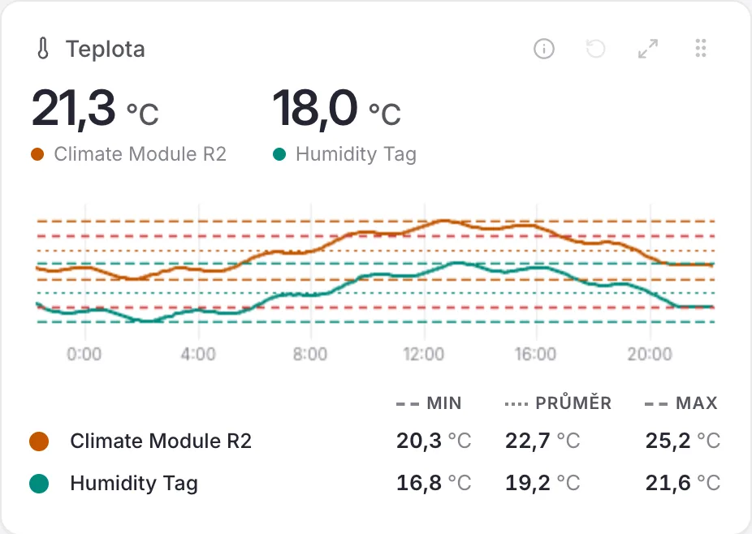

### Relay Module {#relay}

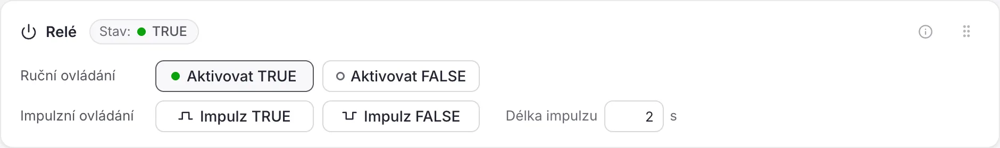

Relé je bistabilní, takže si polohu drží i bez napájení. Jeho stav je **TRUE** (zelená LED na modulu) nebo **FALSE** (červená LED). Po výpadku napájení aplikace polohu nezná; stav je **Neznámý**, dokud relé jednou nepřepnete.

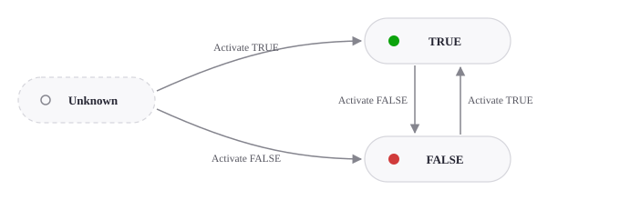

- **Aktivovat TRUE** a **Aktivovat FALSE** relé přepnou.
- **Impulz TRUE** a **Impulz FALSE** přepnou do daného stavu na dobu nastavenou v poli **Délka impulzu** (0,5 s až 1 hodina, výchozí 2 s) a pak zpět. Tlačítko se během impulzu vyplňuje. Dalším kliknutím impulz předčasně ukončíte.

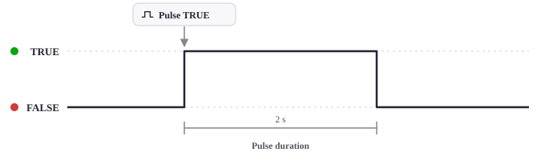

### CO₂ a VOC {#air}

Panely CO₂ a VOC se objeví, když je připojený TOWER CO2 Module nebo VOC-LP Tag.

- **CO₂** v ppm. První hodnota přijde asi minutu po spuštění, zatímco modul nabíjí kondenzátor; potom se měří při každém měření, nejvýše každých 16 sekund. Hodnota je filtrovaná od šumu a korigovaná na tlak vzduchu podle barometru, pokud je připojený. Senzor si každých 8 dní sám opraví základní linii, proto místnost občas vyvětrejte; po novém startu se hodnoty ustálí během několika dní.
- **VOC** (těkavé organické látky celkem) v ppb, měří se každých 30 sekund. První hodnoty přijdou asi po pěti minutách zahřívání. S vlhkoměrem na stejném kanálu se hodnota koriguje na vlhkost.

Oba senzory si naučené hodnoty pamatují i po restartu aplikace.

### GPS {#gps}

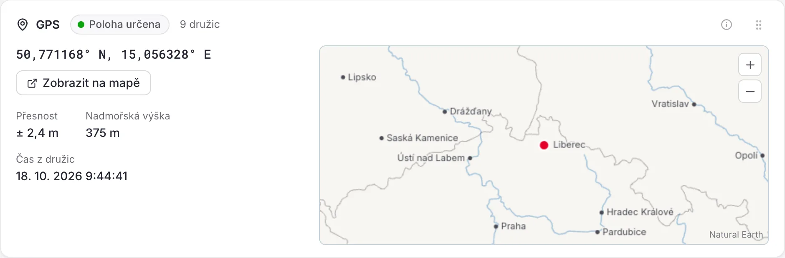

Karta GPS se objeví, když je připojený TOWER GPS Module. Ukazuje, zda má přijímač určenou polohu a kolik družic používá; s určenou polohou také souřadnice, jejich přesnost, nadmořskou výšku a čas z družic. Mapa vedle funguje i bez internetu: státy, řeky, jezera a města, poloha je červená tečka. Tažením se po ní posunete, přiblížíte ji tlačítky + a −, klávesou Ctrl/⌘ s kolečkem myši nebo sevřením prstů; po posunutí mapy přibude třetí tlačítko, které vrátí polohu doprostřed. Ulice ukáže **Zobrazit na mapě**, které otevře polohu v OpenStreetMap. První určení polohy může trvat několik minut a potřebuje výhled na oblohu; se získanou polohou se na modulu rozsvítí zelená LED.

### TOWER NFC Tag {#nfc}

TOWER NFC Tag uchovává webovou adresu. Telefon, který se ho dotkne, ji otevře, například stránku o místnosti nebo zařízení. Karta se objeví, když je tag připojený, a ukazuje adresu na tagu. Napište novou a stiskněte **Zapsat**; bez `https://` se doplní sama. Vejdou se adresy do 240 znaků.

### TOWER Bridge Module {#bridge}

Ukazuje moduly nalezené na jednotlivých kanálech I²C (včetně Relay Module). **Identifikovat** blikne LED na Bridge Module. **Hledat znovu** znovu vyhledá moduly. Když je připojeno více Bridge Module, karta na to upozorní: aplikace čte jen jeden z nich, ten, jehož LED blikne po **Identifikovat**. Ostatní odpojte, jinak se mohou smíchat hodnoty z různých sestav. Karta je na nástěnce vždy poslední.

## Data {#data}

Ukazuje uložené hodnoty za stejná období jako Nástěnka, 1 hodinu až 365 dní, nebo za vlastní období jako tabulku, nejnovější nahoře. Každý řádek je průměr za úsek, který roste s délkou období; jak je dlouhý, říká řádek pod tabulkou. **Exportovat CSV** a **Exportovat XLSX** uloží každou jednotlivou hodnotu zvoleného období; soubory XLSX používají váš formát data a času. Exporty mají jeden řádek pro každé měření a kanál I²C. Grafy jsou na Nástěnce.

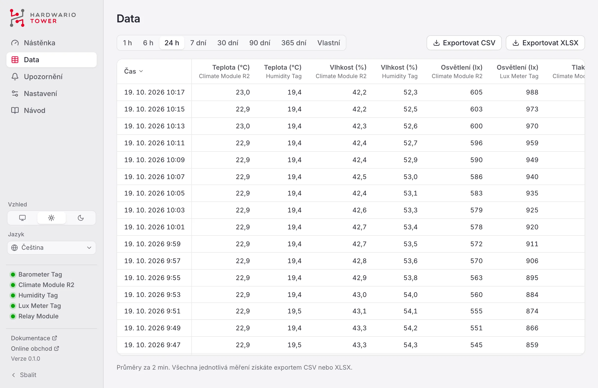

## Upozornění {#alerts}

Pro každou veličinu nastavte dolní limit (**Pod**) a horní limit (**Nad**). Když hodnota opustí rozsah, dostanete oznámení. Limity platí na obou kanálech; když se veličina měří na obou, oznámení uvádí modul.

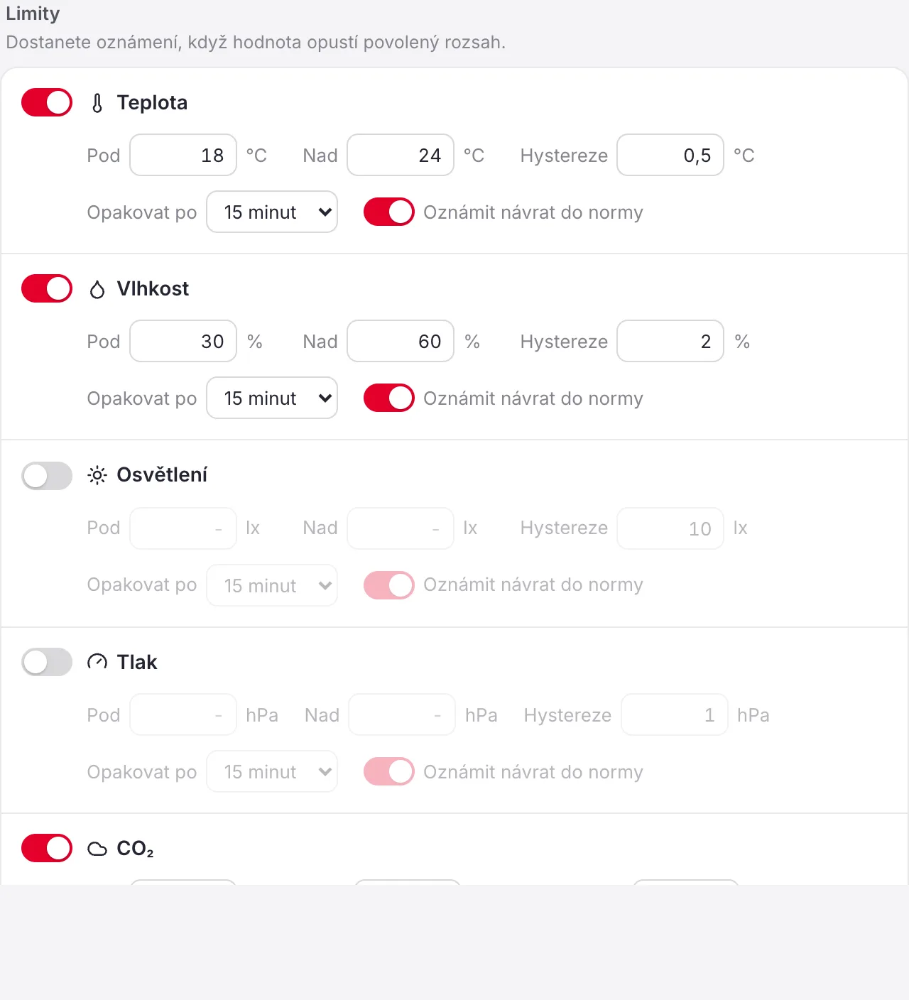

- **Hystereze:** o kolik se hodnota musí vrátit dovnitř limitu, než upozornění skončí, aby hodnota blízko limitu nespouštěla upozornění znovu a znovu.
- **Opakovat po:** nejkratší doba mezi dvěma oznámeními pro stejný limit.
- **Oznámit návrat do normy:** oznámí i to, že je hodnota opět v rozsahu.
- **Odpojení zařízení:** oznámí, když minutu nepřijde žádné měření.

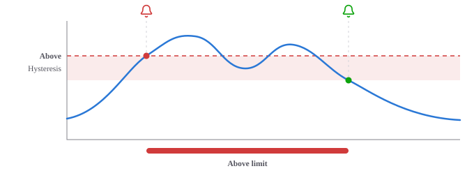

V diagramu hodnota stoupne nad limit: upozornění začne a přijde oznámení (červený zvonek). Pokles do pásma hystereze ho neukončí. Upozornění skončí, až když hodnota klesne pod pásmo; je-li zapnuté **Oznámit návrat do normy**, přijde oznámení (zelený zvonek).

Tlačítko **Odeslat** u Zkušebního oznámení ověří, že oznámení dorazí. Nedávná upozornění jsou vypsána dole.

## Nastavení {#settings}

- **Obecné:** vzhled (podle systému, světlý, tmavý), jazyk, formát data, formát času, desetinný oddělovač (tečka nebo čárka; Automaticky se řídí jazykem), jednotka teploty, hodnota vedle ikony v řádku nabídek nebo oznamovací oblasti a spouštění po přihlášení.
- **Měření:** tlak na hladině moře pro odhad nadmořské výšky a kanály I²C, na kterých se hledají senzory (Automaticky používá oba).
- **Data:** jak dlouho se hodnoty uchovávají a kde je složka s daty.

### MQTT {#mqtt}

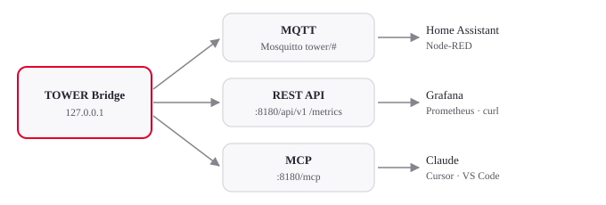

MQTT je ve výchozím stavu vypnuté. Po zapnutí aplikace publikuje každou hodnotu do vašeho vlastního brokeru MQTT, například Mosquitto nebo brokeru v Home Assistant; sama broker neprovozuje. Zadejte **Adresa brokeru** a podle potřeby port, TLS a přihlášení. Změny platí hned a aplikace se k brokeru sama znovu připojí, když vypadne. Stav pod přepínačem říká, zda je připojena.

Každá hodnota se publikuje jako retained zpráva pod prefixem témat (výchozí `tower`) s kanálem I²C na konci: `tower/temperature/0`, `tower/humidity/0`, `tower/illuminance/0`, `tower/pressure/0` a `tower/altitude/0`. Senzory na kanálu 1 publikují na `tower/temperature/1` a tak dále. TOWER CO2 Module publikuje na `tower/co2/0` (ppm), VOC-LP Tag na `tower/voc/0` (ppb) a TOWER GPS Module na `tower/gps/0/latitude`, `/longitude`, `/altitude` a `/satellites`. Stav relé se publikuje na `tower/relay/0` (kanál Relay Module) jako `true`, `false`, nebo `null`, dokud není znám. `tower/status` říká `online`, dokud aplikace publikuje, a `offline`, když přestane.

Se zapnutým **Povolit ovládání relé** přijímá relé `true` nebo `false` na `tower/relay/0/set` a impulz na `tower/relay/0/pulse`.

### API a MCP {#api}

Volitelný místní server nabízí REST API, metriky pro Prometheus a server MCP pro AI asistenty; ve výchozím stavu je vypnutý. Změny, jako jsou limity upozornění nebo přepínání relé, vyžadují **Povolit změny**. Jiné počítače musí posílat přístupový token uvedený v nastavení.

## Řešení potíží {#troubleshooting}

- **Zařízení není připojeno:** zkontrolujte kabel USB. Zařízení může současně používat jen jeden program, ukončete proto jiné nástroje, které ho mohou držet.
- **Chybí oprávnění (Linux):** nainstalujte [pravidlo udev](#install) a zařízení znovu připojte.
- **Senzory nenalezeny:** zkontrolujte, že jsou moduly a tagy dobře zasunuté, a stiskněte **Hledat znovu**. Kanály I²C nechte na Automaticky, nebo nastavte kanál, ke kterému jsou připojeny.
- **Stav relé je neznámý:** přepněte relé jednou pomocí Aktivovat TRUE nebo Aktivovat FALSE.
- **Oznámení nechodí:** povolte oznámení pro TOWER Bridge v nastavení systému a použijte **Odeslat** u Zkušebního oznámení.

## O aplikaci {#about}

TOWER Bridge je otevřený software pod licencí MIT, © HARDWARIO a.s. Dokumentace platformy TOWER je na [docs.hardwario.com/tower](https://docs.hardwario.com/tower/); hardware koupíte v [online obchodě HARDWARIO](https://www.hardwario.store/).
