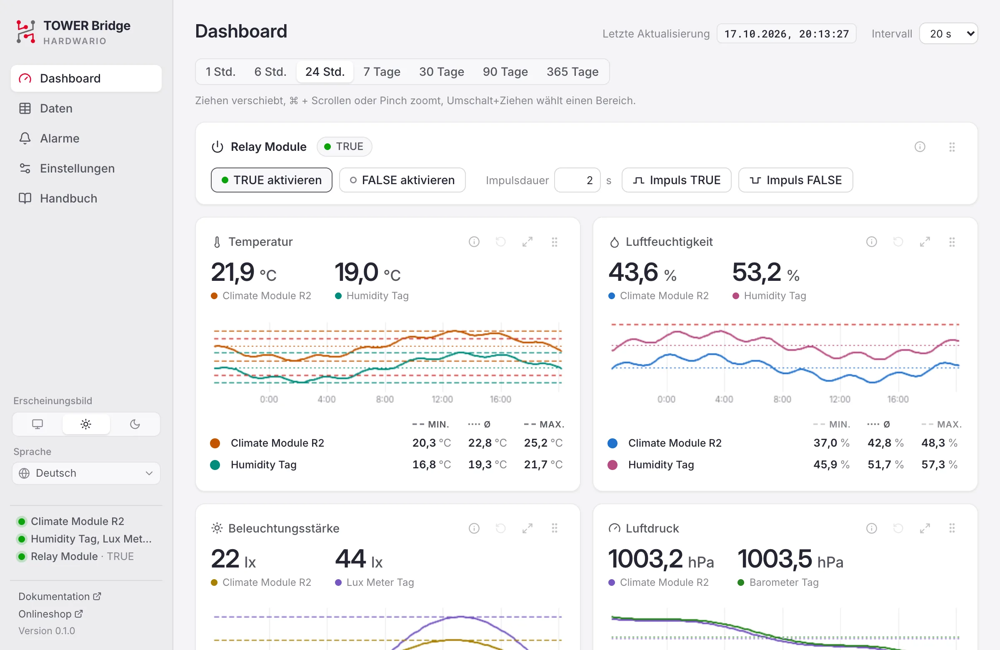
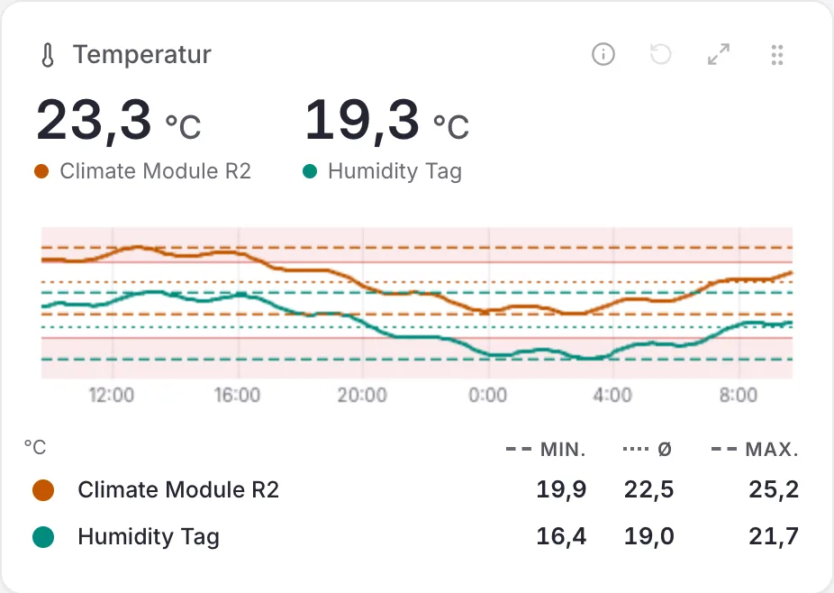
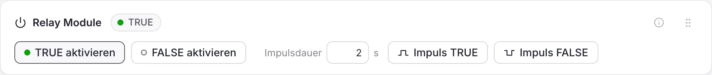
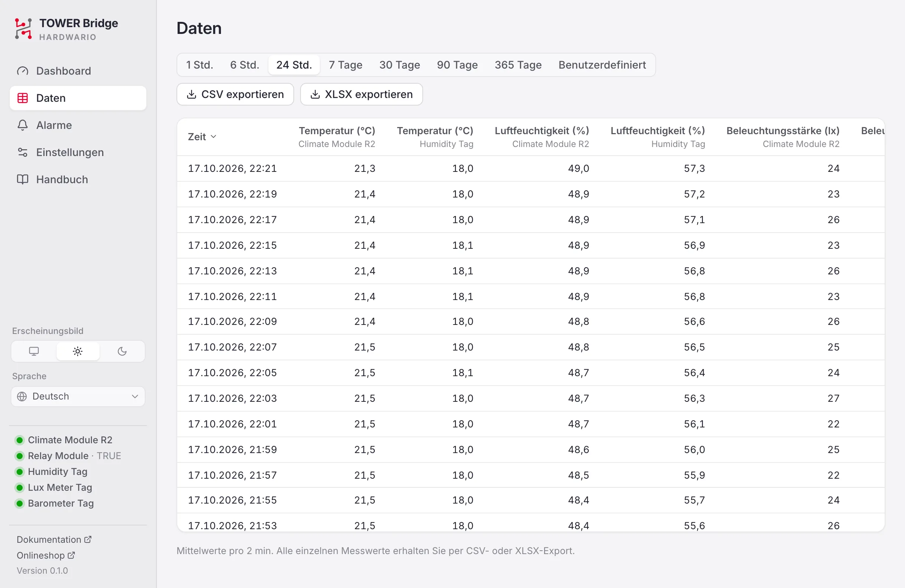
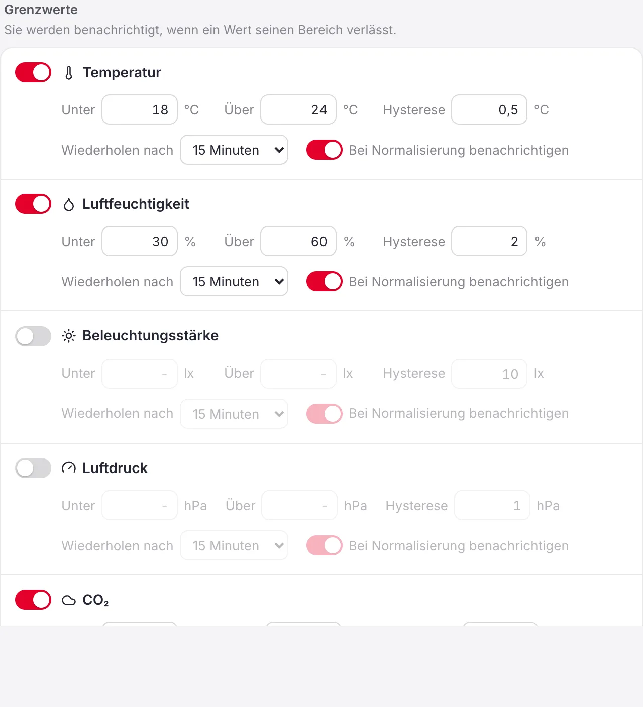

# TOWER Bridge Handbuch

TOWER Bridge zeigt die Messwerte des HARDWARIO TOWER Climate Module und der TOWER Sensor-Tags an, die über das TOWER Bridge Module angeschlossen sind, speichert ihren Verlauf und schaltet das TOWER Relay Module. Dieses Handbuch beschreibt Version {version}.

## Einführung {#introduction}

Sie benötigen:

- **TOWER Bridge Module**, per USB mit dem Computer verbunden.
- **TOWER Climate Module** (Revision R1 oder R2) für Temperatur, relative Luftfeuchtigkeit, Beleuchtungsstärke und Luftdruck.
- Optional TOWER Sensor-Tags: **Humidity Tag**, **Temperature Tag**, **Lux Meter Tag** und **Barometer Tag**, allein oder neben dem Climate Module.
- Optional ein **TOWER Relay Module**, ein bistabiles Relais, das Sie aus der App schalten.

Die App läuft in der Menüleiste (macOS) oder im Infobereich der Taskleiste (Windows, Linux). Sie misst auch bei geschlossenem Fenster weiter.

## Erste Schritte {#getting-started}

### Installation {#install}

- **macOS:** Öffnen Sie die DMG-Datei und ziehen Sie TOWER Bridge in den Ordner Programme.
- **Windows:** Starten Sie die EXE-Datei. Eine Installation ist nicht nötig; das Fenster nutzt WebView2, das Teil von Windows 11 ist.
- **Linux:** Machen Sie die AppImage-Datei ausführbar und starten Sie sie. Installieren Sie die udev-Regel aus dem Projekt, damit die App das Gerät ohne Administratorrechte öffnen kann.

### Hardware anschließen {#connect}

Stecken Sie das Climate Module und gegebenenfalls das Relay Module auf das Bridge Module und verbinden Sie es per USB. Die App findet die Module innerhalb weniger Sekunden. Wenn Sie Module bei laufender App wechseln, drücken Sie im Dashboard **Neu suchen**.

Das Relay Module und die Tags sind optional, daher die gestrichelten Rahmen.

Das Bridge Module hat zwei I²C-Kanäle, und auf beiden können Sensoren sitzen, zum Beispiel das Climate Module drinnen an Kanal 0 und Tags draußen an Kanal 1. Die App sucht auf beiden Kanälen und findet einen Tag, der bei laufender App angeschlossen wird, innerhalb einer Minute.

### Menüleiste und Infobereich {#tray}

Das Symbol zeigt den aktuellen Wert der in den Einstellungen gewählten Messgröße. Sein Menü öffnet das Dashboard, listet alle Messwerte und den Verbindungsstatus auf, schaltet **Bei Anmeldung öffnen** und MQTT ein oder aus und beendet die App. Wenn Sie das Dashboard-Fenster schließen, läuft die App weiter. Wird eine Messgröße auf beiden Kanälen gemessen, zeigt das Menü beide Werte, Kanal 0 zuerst.

## Dashboard {#dashboard}

Das Dashboard zeigt das Relay Module, den letzten Wert jeder Messgröße mit Diagramm und das TOWER Bridge Module. **Letzte Aktualisierung** oben gibt an, wann zuletzt gemessen wurde. Daneben legt **Intervall** fest, wie oft die Sensoren messen, von 5 Sekunden bis 3 Minuten (standardmäßig 20 Sekunden).

### Diagramme {#charts}

1. **Farbe:** wählt die Linienfarbe.
2. **Datenquelle:** Zeigen Sie auf das Symbol ⓘ, um Modul, I²C-Kanal, Adresse und Sensor der Werte zu sehen.
3. **Zurücksetzen:** kehrt zum gewählten Zeitraum zurück.
4. **Maximieren:** vergrößert das Diagramm; ein weiterer Klick oder <kbd>Esc</kbd> stellt es wieder her.
5. **Verschieben:** Ziehen Sie das Panel an eine neue Stelle; die Reihenfolge wird gespeichert.
6. **Diagramm:** Zeigen Sie darauf, um den genauen Wert und die Uhrzeit zu sehen.
7. **Min, Mittel, Max:** für den sichtbaren Bereich. Ein Klick blendet die zugehörige Linie im Diagramm ein oder aus.

Wählen Sie den Zeitraum über den Diagrammen, von 1 Stunde bis 365 Tage. Alle Diagramme einer Seite bewegen sich gemeinsam.

| Aktion | So geht es |
|---|---|
| Verschieben | Diagramm nach links oder rechts ziehen |
| Zoomen | <kbd>Strg</kbd> + Scrollen (<kbd>⌘</kbd> + Scrollen unter macOS) oder Zoomgeste auf dem Touchpad |
| Bereich vergrößern | <kbd>Umschalt</kbd> + Ziehen |
| Zurück zum Zeitraum | Zurücksetzen-Symbol (4) |

Ein roter Rand oben an einem Panel bedeutet, dass der Wert außerhalb seiner Alarmgrenzen liegt; die gestrichelte rote Linie im Diagramm zeigt die Grenze.

Wird dieselbe Messgröße auf beiden Kanälen gemessen, etwa die Temperatur vom Climate Module und vom Humidity Tag, zeigt ihr Panel beide Werte, für jeden Kanal eine Linie in eigener Farbe und unter dem Diagramm je eine Zeile mit Min, Mittel und Max. Der farbige Punkt am Anfang einer Zeile wählt die Farbe ihrer Linie; die Spaltenköpfe blenden die Min-, Mittel- und Max-Linien ein oder aus. Ein Klick auf den Namen einer Zeile, etwa *Humidity Tag*, blendet ihre Linie im Diagramm aus; die Zeile wird grau, und ein weiterer Klick holt die Linie zurück. Eine Linie bleibt immer.

### Relay Module {#relay}

Das Relais ist bistabil und behält seine Stellung auch ohne Strom. Sein Zustand ist **TRUE** (grüne LED am Modul) oder **FALSE** (rote LED). Nach einem Stromausfall kennt die App die Stellung nicht; der Zustand ist **Unbekannt**, bis Sie das Relais einmal schalten.

- **TRUE aktivieren** und **FALSE aktivieren** schalten das Relais.
- **Impuls TRUE** und **Impuls FALSE** schalten für die **Impulsdauer** (0,5 s bis 1 Stunde, standardmäßig 2 s) in diesen Zustand und danach zurück. Die Schaltfläche füllt sich, während der Impuls läuft. Ein weiterer Klick beendet den Impuls vorzeitig.

### TOWER Bridge Module {#bridge}

Zeigt die auf jedem I²C-Kanal erkannten Module (auch das Relay Module). **Identifizieren** lässt die LED am Bridge Module blinken. **Neu suchen** sucht erneut nach Modulen. Sind mehrere Bridge Module angeschlossen, warnt die Karte: Die App liest nur eines davon, das, dessen LED bei **Identifizieren** blinkt. Trennen Sie die anderen, sonst können sich Messwerte verschiedener Aufbauten vermischen.

## Daten {#data}

Zeigt die gespeicherten Messwerte für dieselben Zeitspannen wie das Dashboard, 1 Stunde bis 365 Tage, oder für einen eigenen Zeitraum als Tabelle, die neuesten oben. Jede Zeile mittelt einen Abschnitt, der mit dem Zeitraum wächst; wie lang er ist, steht unter der Tabelle. **CSV exportieren** und **XLSX exportieren** speichern jeden einzelnen Messwert des gewählten Zeitraums; XLSX-Dateien verwenden Ihr Datums- und Zeitformat. Exporte enthalten eine Zeile pro Messung und I²C-Kanal. Die Diagramme sind im Dashboard.

## Alarme {#alerts}

Legen Sie für jede Messgröße eine untere Grenze (**Unter**) und eine obere Grenze (**Über**) fest. Verlässt ein Wert seinen Bereich, erhalten Sie eine Benachrichtigung. Die Grenzen gelten auf beiden Kanälen; wird eine Messgröße auf beiden gemessen, nennt die Benachrichtigung das Modul.

- **Hysterese:** wie weit der Wert in die Grenze zurückkehren muss, bevor der Alarm endet, damit ein Wert nahe der Grenze nicht immer wieder Alarme auslöst.
- **Wiederholen nach:** die kürzeste Zeit zwischen zwei Benachrichtigungen für dieselbe Grenze.
- **Bei Normalisierung benachrichtigen:** meldet auch, wenn der Wert wieder im Bereich liegt.
- **Gerät getrennt:** meldet, wenn eine Minute lang keine Messung eintrifft.

Im Diagramm steigt der Wert über die Grenze: Der Alarm beginnt und Sie erhalten eine Benachrichtigung (rote Glocke). Ein Absinken in das Hystereseband beendet ihn nicht. Erst wenn der Wert unter das Band fällt, endet der Alarm; ist **Bei Normalisierung benachrichtigen** eingeschaltet, kommt eine Benachrichtigung (grüne Glocke).

**Senden** bei Testbenachrichtigung prüft, ob Benachrichtigungen ankommen. Die letzten Alarme stehen unten.

## Einstellungen {#settings}

- **Allgemein:** Darstellung (System, hell, dunkel), Sprache, Datumsformat, Zeitformat, Dezimaltrennzeichen (Punkt oder Komma; Automatisch richtet sich nach der Sprache), Temperatureinheit, der Wert neben dem Symbol in der Menüleiste oder im Infobereich und das Öffnen bei Anmeldung.
- **Messung:** der Luftdruck auf Meereshöhe für die Höhenschätzung und die I²C-Kanäle, auf denen nach Sensoren gesucht wird (Automatisch nutzt beide).
- **Daten:** wie lange Messwerte aufbewahrt werden und wo der Datenordner liegt.

### MQTT {#mqtt}

MQTT ist standardmäßig aus. Eingeschaltet veröffentlicht die App jeden Messwert auf Ihrem eigenen MQTT-Broker, zum Beispiel Mosquitto oder dem Broker in Home Assistant; einen eigenen Broker betreibt sie nicht. Geben Sie die **Broker-Adresse** ein und bei Bedarf Port, TLS und Anmeldung. Änderungen gelten sofort, und die App verbindet sich von selbst neu, wenn der Broker weg war. Der Status unter dem Schalter zeigt, ob sie verbunden ist.

Jeder Messwert wird als Retained-Nachricht unter dem Topic-Präfix (standardmäßig `tower`) mit dem I²C-Kanal am Ende veröffentlicht: `tower/temperature/0`, `tower/humidity/0`, `tower/illuminance/0`, `tower/pressure/0` und `tower/altitude/0`. Sensoren an Kanal 1 veröffentlichen auf `tower/temperature/1` und so weiter. Der Relaiszustand wird auf `tower/relay/0` (dem Kanal des Relay Module) als `true`, `false` oder, solange er unbekannt ist, `null` veröffentlicht. `tower/status` meldet `online`, solange die App veröffentlicht, und `offline`, wenn sie aufhört.

Mit eingeschaltetem **Relaissteuerung erlauben** nimmt das Relais `true` oder `false` auf `tower/relay/0/set` und einen Impuls auf `tower/relay/0/pulse` an.

### API und MCP {#api}

Der optionale lokale Server bietet eine REST-API, Prometheus-Metriken und einen MCP-Server für KI-Assistenten; standardmäßig ist er aus. Änderungen wie Alarmgrenzen oder das Schalten des Relais erfordern **Änderungen erlauben**. Andere Computer müssen das in den Einstellungen angezeigte Zugriffstoken senden.

## Fehlerbehebung {#troubleshooting}

- **Gerät nicht verbunden:** Prüfen Sie das USB-Kabel. Nur ein Programm kann das Gerät gleichzeitig nutzen; beenden Sie daher andere Werkzeuge, die es belegen könnten.
- **Keine Berechtigung (Linux):** Installieren Sie die [udev-Regel](#install) und schließen Sie das Gerät neu an.
- **Keine Sensoren gefunden:** Prüfen Sie, ob Module und Tags richtig sitzen, und drücken Sie **Neu suchen**. Lassen Sie die I²C-Kanäle auf Automatisch oder stellen Sie den Kanal ein, an dem sie angeschlossen sind.
- **Relaiszustand unbekannt:** Schalten Sie das Relais einmal mit TRUE aktivieren oder FALSE aktivieren.
- **Keine Benachrichtigungen:** Erlauben Sie Benachrichtigungen für TOWER Bridge in den Systemeinstellungen und verwenden Sie **Senden** bei Testbenachrichtigung.

## Über {#about}

TOWER Bridge ist Open Source unter der MIT-Lizenz, © HARDWARIO a.s. Die Dokumentation der TOWER-Plattform finden Sie unter [docs.hardwario.com/tower](https://docs.hardwario.com/tower/); die Hardware gibt es im [HARDWARIO Onlineshop](https://www.hardwario.store/).
