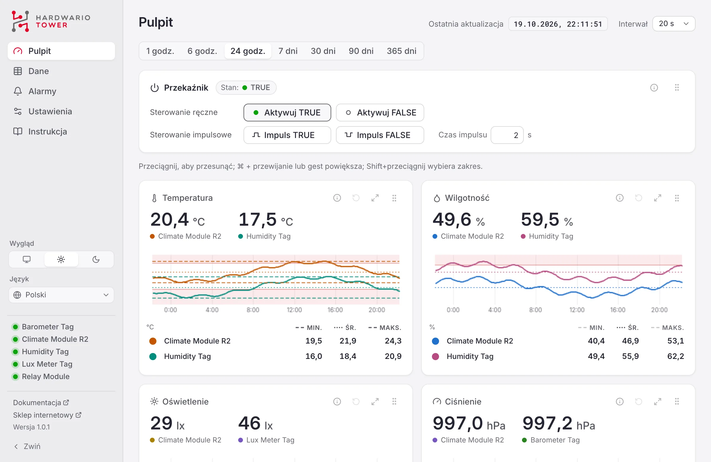
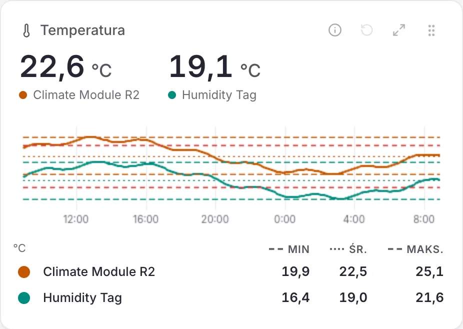
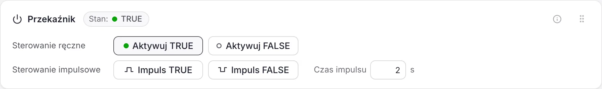
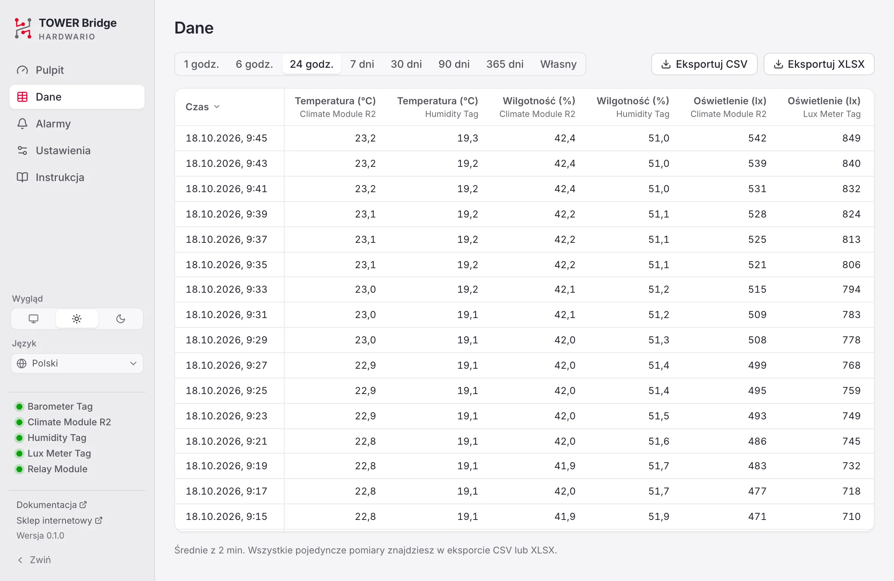
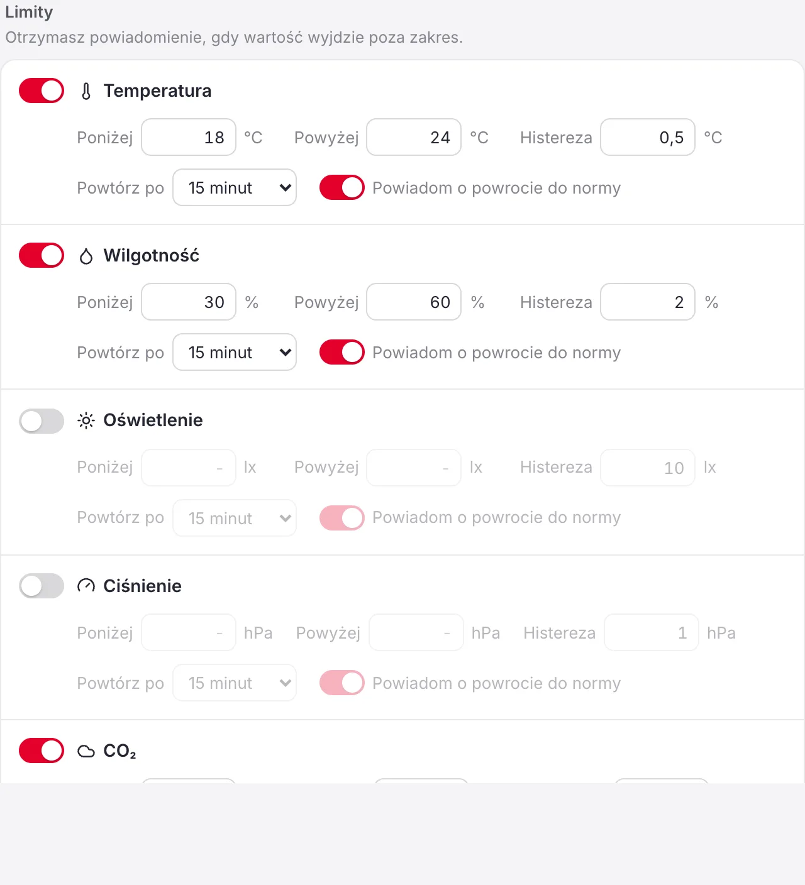

# Instrukcja aplikacji TOWER Bridge

TOWER Bridge pokazuje odczyty z modułu HARDWARIO TOWER Climate Module i tagów czujników TOWER podłączonych przez TOWER Bridge Module, przechowuje ich historię i przełącza TOWER Relay Module. Instrukcja opisuje wersję {version}.

## Wprowadzenie {#introduction}

Potrzebujesz:

- **TOWER Bridge Module** podłączonego do komputera przez USB.
- **TOWER Climate Module** (rewizja R1 lub R2) do pomiaru temperatury, wilgotności względnej, natężenia oświetlenia i ciśnienia atmosferycznego.
- Opcjonalnie tagi czujników TOWER: **Humidity Tag**, **Temperature Tag**, **Lux Meter Tag** i **Barometer Tag**, same lub obok Climate Module.
- Opcjonalnie **TOWER Relay Module**, przekaźnika bistabilnego, którym sterujesz z aplikacji.

Aplikacja działa na pasku menu (macOS) lub w zasobniku systemowym (Windows, Linux). Mierzy także przy zamkniętym oknie.

## Pierwsze kroki {#getting-started}

### Instalacja {#install}

- **macOS:** otwórz plik DMG i przeciągnij TOWER Bridge do folderu Aplikacje.
- **Windows:** uruchom plik EXE. Instalacja nie jest potrzebna; okno korzysta z WebView2, który jest częścią Windows 11.
- **Linux:** nadaj plikowi AppImage prawo do uruchamiania i uruchom go. Zainstaluj regułę udev z projektu, aby aplikacja mogła otworzyć urządzenie bez uprawnień administratora.

### Podłączenie sprzętu {#connect}

Włóż Climate Module, a jeśli go masz, także Relay Module, do Bridge Module i podłącz go przez USB. Aplikacja znajdzie moduły w ciągu kilku sekund. Po wymianie modułów w trakcie działania aplikacji naciśnij na Pulpicie **Wyszukaj ponownie**.

Relay Module i tagi są opcjonalne, dlatego mają przerywany obrys.

Bridge Module ma dwa kanały I²C, a czujniki mogą być na obu, na przykład Climate Module w środku na kanale 0 i tagi na zewnątrz na kanale 1. Aplikacja szuka na obu kanałach, a tag podłączony w trakcie działania znajduje w ciągu minuty.

### Pasek menu i zasobnik {#tray}

Ikona pokazuje bieżącą wartość wielkości wybranej w ustawieniach. Jej menu otwiera pulpit, wyświetla wszystkie odczyty i stan połączenia, włącza i wyłącza **Uruchamiaj przy logowaniu** oraz MQTT i zamyka aplikację. Po zamknięciu okna pulpitu aplikacja działa dalej. Gdy wielkość jest mierzona na obu kanałach, menu pokazuje obie wartości, najpierw kanał 0.

## Pulpit {#dashboard}

Pulpit pokazuje Relay Module, ostatnią wartość każdej wielkości z wykresem oraz TOWER Bridge Module. **Ostatnia aktualizacja** u góry mówi, kiedy wykonano ostatni pomiar. Obok **Interwał** określa, jak często czujniki wykonują pomiar, od 5 sekund do 3 minut (domyślnie 20 sekund).

### Wykresy {#charts}

1. **Kolor:** wybiera kolor linii.
2. **Źródło danych:** wskaż ikonę ⓘ, aby zobaczyć moduł, kanał I²C, adres i czujnik, z którego pochodzą wartości.
3. **Reset:** przywraca wybrany zakres czasu.
4. **Maksymalizacja:** powiększa wykres; ponowne kliknięcie lub klawisz <kbd>Esc</kbd> go przywraca.
5. **Przesuwanie panelu:** przeciągnij panel w nowe miejsce; kolejność zostanie zapamiętana.
6. **Wykres:** wskaż go, aby zobaczyć dokładną wartość i czas.
7. **Min, średnia, max:** dla widocznego zakresu. Kliknięcie pokazuje lub ukrywa ich linię na wykresie.

Zakres czasu wybierz nad wykresami, od 1 godziny do 365 dni. Wszystkie wykresy na stronie przesuwają się razem.

| Czynność | Jak to zrobić |
|---|---|
| Przesuwanie | Przeciągnij wykres w lewo lub w prawo |
| Powiększanie | <kbd>Ctrl</kbd> + przewijanie (w macOS <kbd>⌘</kbd> + przewijanie) lub gest na touchpadzie |
| Powiększenie zakresu | <kbd>Shift</kbd> + przeciągnięcie |
| Powrót do zakresu czasu | Ikona resetu (4) |

Czerwona krawędź u góry panelu oznacza, że wartość jest poza granicami alarmu; przerywana czerwona linia na wykresie pokazuje granicę.

Gdy ta sama wielkość jest mierzona na obu kanałach, na przykład temperaturę mierzy Climate Module i Humidity Tag, jej panel pokazuje obie wartości, dla każdego kanału linię we własnym kolorze, a pod wykresem dla każdego z nich wiersz z min, średnią i max. Kolorowa kropka na początku wiersza wybiera kolor jego linii, a nagłówki kolumn włączają i wyłączają linie min, średniej i max. Kliknięcie nazwy wiersza, na przykład *Humidity Tag*, ukrywa jego linię na wykresie; wiersz robi się szary, a kolejne kliknięcie przywraca linię. Jedna linia zawsze zostaje.

### Relay Module {#relay}

Przekaźnik jest bistabilny, więc utrzymuje położenie bez zasilania. Jego stan to **TRUE** (zielona dioda na module) lub **FALSE** (czerwona dioda). Po zaniku zasilania aplikacja nie zna położenia; stan jest **Nieznany**, dopóki raz nie przełączysz przekaźnika.

- **Aktywuj TRUE** i **Aktywuj FALSE** przełączają przekaźnik.
- **Impuls TRUE** i **Impuls FALSE** przełączają do danego stanu na **Czas impulsu** (od 0,5 s do 1 godziny, domyślnie 2 s), a potem z powrotem. Przycisk wypełnia się w trakcie impulsu. Ponowne kliknięcie kończy impuls wcześniej.

### TOWER Bridge Module {#bridge}

Pokazuje moduły wykryte na każdym kanale I²C (w tym Relay Module). **Identyfikuj** miga diodą na Bridge Module. **Wyszukaj ponownie** ponownie szuka modułów. Gdy podłączono więcej niż jeden Bridge Module, karta ostrzega: aplikacja odczytuje tylko jeden z nich, ten, którego dioda miga po **Identyfikuj**. Odłącz pozostałe, w przeciwnym razie odczyty z różnych zestawów mogą się wymieszać.

## Dane {#data}

Pokazuje zapisane odczyty z tych samych okresów co Pulpit, od 1 godziny do 365 dni, lub z własnego zakresu jako tabelę, najnowsze na górze. Każdy wiersz to średnia z odcinka, który rośnie wraz z zakresem; jego długość podaje wiersz pod tabelą. **Eksportuj CSV** i **Eksportuj XLSX** zapisują każdy pojedynczy odczyt z wybranego zakresu; pliki XLSX używają Twojego formatu daty i czasu. Eksporty mają jeden wiersz na każdy pomiar i kanał I²C. Wykresy są na Pulpicie.

## Alarmy {#alerts}

Dla każdej wielkości ustaw dolną granicę (**Poniżej**) i górną granicę (**Powyżej**). Gdy wartość opuści zakres, otrzymasz powiadomienie. Granice obowiązują na obu kanałach; gdy wielkość jest mierzona na obu, powiadomienie podaje moduł.

- **Histereza:** o ile wartość musi wrócić do wnętrza granicy, zanim alarm się zakończy, aby wartość bliska granicy nie wywoływała alarmów raz po raz.
- **Powtórz po:** najkrótszy czas między dwoma powiadomieniami dla tej samej granicy.
- **Powiadom o powrocie do normy:** informuje także, że wartość znów jest w zakresie.
- **Odłączenie urządzenia:** powiadamia, gdy przez minutę nie nadejdzie żaden pomiar.

Na diagramie wartość rośnie powyżej granicy: alarm się zaczyna i otrzymujesz powiadomienie (czerwony dzwonek). Spadek do pasma histerezy go nie kończy. Alarm kończy się dopiero, gdy wartość spadnie poniżej pasma; jeśli włączone jest **Powiadom o powrocie do normy**, przychodzi powiadomienie (zielony dzwonek).

Przycisk **Wyślij** przy Powiadomieniu testowym sprawdza, czy powiadomienia docierają. Ostatnie alarmy są wymienione na dole.

## Ustawienia {#settings}

- **Ogólne:** wygląd (systemowy, jasny, ciemny), język, format daty, format czasu, separator dziesiętny (kropka lub przecinek; Automatycznie zależy od języka), jednostka temperatury, wartość obok ikony na pasku menu lub w zasobniku oraz uruchamianie przy logowaniu.
- **Pomiar:** ciśnienie na poziomie morza do szacowania wysokości oraz kanały I²C, na których szukane są czujniki (Automatycznie używa obu).
- **Dane:** jak długo przechowywane są odczyty i gdzie jest folder danych.

### MQTT {#mqtt}

MQTT jest domyślnie wyłączone. Po włączeniu aplikacja publikuje każdy odczyt w Twoim własnym brokerze MQTT, na przykład Mosquitto lub brokerze w Home Assistant; sama nie uruchamia brokera. Wpisz **Adres brokera**, a w razie potrzeby port, TLS i logowanie. Zmiany obowiązują od razu, a aplikacja sama łączy się ponownie, gdy broker zniknie. Stan pod przełącznikiem mówi, czy jest połączona.

Każdy odczyt jest publikowany jako wiadomość retained pod prefiksem tematów (domyślnie `tower`) z kanałem I²C na końcu: `tower/temperature/0`, `tower/humidity/0`, `tower/illuminance/0`, `tower/pressure/0` i `tower/altitude/0`. Czujniki na kanale 1 publikują na `tower/temperature/1` i tak dalej. Stan przekaźnika jest publikowany na `tower/relay/0` (kanał Relay Module) jako `true`, `false` lub `null`, dopóki jest nieznany. `tower/status` mówi `online`, dopóki aplikacja publikuje, i `offline`, gdy przestanie.

Po włączeniu **Zezwalaj na sterowanie przekaźnikiem** przekaźnik przyjmuje `true` lub `false` na `tower/relay/0/set` i impuls na `tower/relay/0/pulse`.

### API i MCP {#api}

Opcjonalny lokalny serwer udostępnia REST API, metryki Prometheus i serwer MCP dla asystentów AI; domyślnie jest wyłączony. Zmiany, takie jak granice alarmów lub przełączanie przekaźnika, wymagają **Zezwalaj na zmiany**. Inne komputery muszą wysyłać token dostępu pokazany w ustawieniach.

## Rozwiązywanie problemów {#troubleshooting}

- **Urządzenie niepodłączone:** sprawdź kabel USB. Z urządzenia może jednocześnie korzystać tylko jeden program, więc zamknij inne narzędzia, które mogą go używać.
- **Brak uprawnień (Linux):** zainstaluj [regułę udev](#install) i podłącz urządzenie ponownie.
- **Nie znaleziono czujników:** sprawdź, czy moduły i tagi są dobrze osadzone, i naciśnij **Wyszukaj ponownie**. Pozostaw kanały I²C na Automatycznie lub ustaw kanał, do którego są podłączone.
- **Stan przekaźnika nieznany:** przełącz przekaźnik raz przyciskiem Aktywuj TRUE lub Aktywuj FALSE.
- **Brak powiadomień:** zezwól na powiadomienia dla TOWER Bridge w ustawieniach systemu i użyj **Wyślij** przy Powiadomieniu testowym.

## O aplikacji {#about}

TOWER Bridge to oprogramowanie open source na licencji MIT, © HARDWARIO a.s. Dokumentacja platformy TOWER jest na [docs.hardwario.com/tower](https://docs.hardwario.com/tower/); sprzęt kupisz w [sklepie internetowym HARDWARIO](https://www.hardwario.store/).
