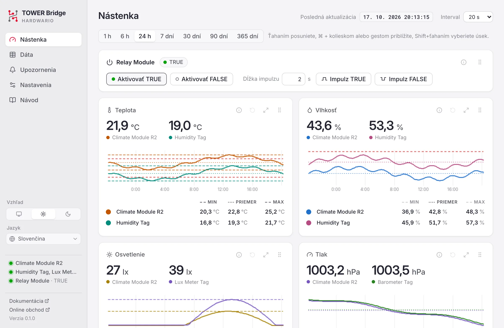
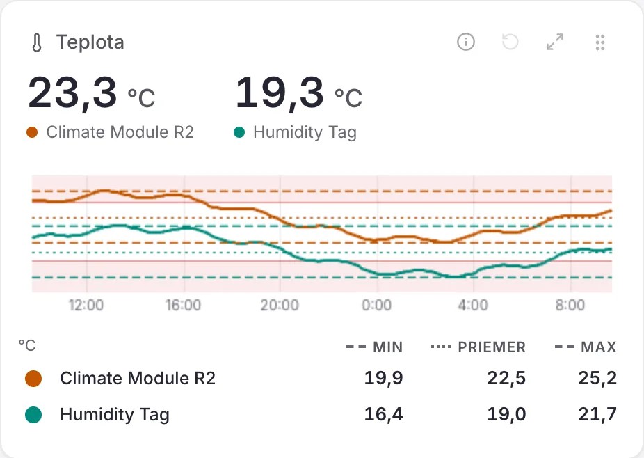
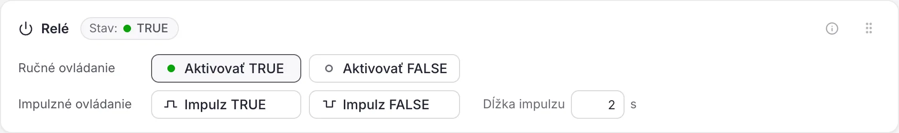
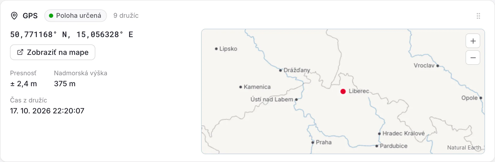
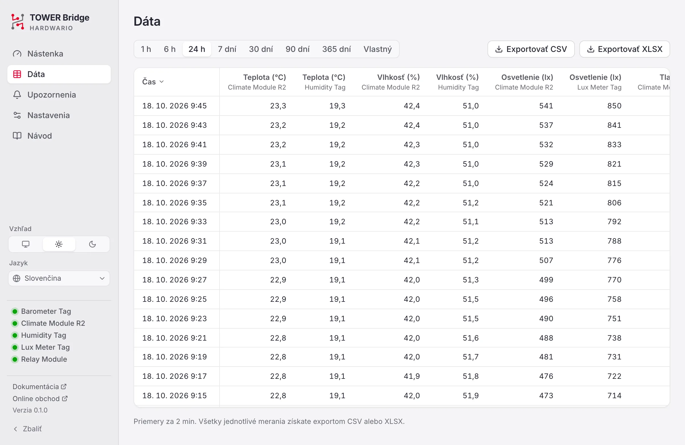
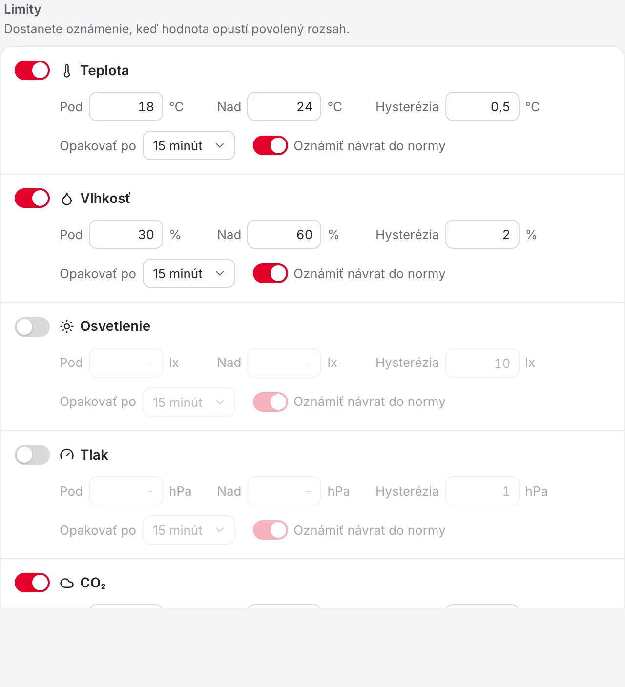

# Návod k aplikácii TOWER Bridge

TOWER Bridge zobrazuje hodnoty z modulu HARDWARIO TOWER Climate Module a senzorových tagov TOWER pripojených cez TOWER Bridge Module, ukladá ich históriu a ovláda TOWER Relay Module. Návod opisuje verziu {version}.

## Úvod {#introduction}

Potrebujete:

- **TOWER Bridge Module** pripojený k počítaču cez USB.
- **TOWER Climate Module** (revízia R1 alebo R2) pre teplotu, relatívnu vlhkosť, osvetlenie a atmosférický tlak.
- Voliteľne senzorové tagy TOWER, samostatne alebo vedľa Climate Module:
  - **TOWER Humidity Tag**
  - **TOWER Temperature Tag**
  - **TOWER Lux Meter Tag**
  - **TOWER Barometer Tag**
- Voliteľne **TOWER Relay Module**, bistabilné relé, ktoré ovládate z aplikácie.
- Voliteľne **TOWER NFC Tag**, ktorý odovzdá zvolenú webovú adresu telefónu, ktorý sa ho dotkne.
- Voliteľne **TOWER CO2 Module** (oxid uhličitý), **TOWER VOC-LP Tag** (prchavé organické látky) a **TOWER GPS Module** (poloha).

Aplikácia beží v lište ponúk (macOS) alebo v oblasti oznámení (Windows, Linux). Meria aj so zatvoreným oknom.

## Prvé kroky {#getting-started}

### Inštalácia {#install}

- **macOS:** otvorte súbor DMG a presuňte TOWER Bridge do priečinka Aplikácie.
- **Windows:** spustite súbor EXE. Inštalácia nie je potrebná; okno používa WebView2, ktorý je súčasťou Windows 11.
- **Linux:** nastavte súboru AppImage právo na spustenie a spustite ho. Nainštalujte pravidlo udev z projektu, aby aplikácia mohla otvoriť zariadenie bez práv správcu.

### Pripojenie hardvéru {#connect}

Zasuňte Climate Module, prípadne aj Relay Module, do Bridge Module a pripojte ho cez USB. Aplikácia moduly nájde za niekoľko sekúnd. Keď moduly vymeníte počas behu aplikácie, stlačte na Nástenke **Hľadať znova**.

Relay Module a tagy sú voliteľné, preto majú prerušovaný obrys.

Bridge Module má dva kanály I²C a senzory môžu byť na oboch, napríklad Climate Module vnútri na kanáli 0 a tagy vonku na kanáli 1. Aplikácia hľadá na oboch kanáloch a tag pripojený počas behu nájde do minúty.

### Lišta ponúk a oblasť oznámení {#tray}

Ikona ukazuje aktuálnu hodnotu veličiny zvolenej v nastaveniach. Jej ponuka otvára nástenku, vypisuje všetky hodnoty a stav pripojenia, zapína a vypína **Spúšťať po prihlásení** a MQTT a ukončuje aplikáciu. Zatvorením okna nástenky aplikácia beží ďalej. Keď sa veličina meria na oboch kanáloch, ponuka ukazuje obe hodnoty, kanál 0 prvý.

## Nástenka {#dashboard}

Nástenka ukazuje Relay Module, poslednú hodnotu každej veličiny s grafom, karty TOWER NFC Tag a TOWER GPS Module, ak sú pripojené, a TOWER Bridge Module. **Zbaliť** dole v bočnom paneli ho zbalí na ikony; šípka na tom istom mieste ho znova rozbalí. Panel alebo čiaru má len to, čo je práve pripojené; hodnoty modulu, ktorý bol medzitým odpojený, zostávajú na stránke Dáta. **Posledná aktualizácia** hore hovorí, kedy prebehlo posledné meranie. Vedľa nej **Interval** určuje, ako často sa senzory merajú, od 5 sekúnd do 3 minút (predvolene 20 sekúnd).

### Grafy {#charts}

1. **Farba:** vyberá farbu čiary.
2. **Zdroj dát:** prejdite myšou na ikonu ⓘ a uvidíte modul, kanál I²C, adresu a senzor, z ktorého hodnoty pochádzajú.
3. **Obnovenie:** vráti zvolené časové obdobie.
4. **Maximalizácia:** zväčší graf; ďalším stlačením alebo klávesom <kbd>Esc</kbd> ho vrátite.
5. **Presun:** presuňte panel na nové miesto; poradie sa zapamätá.
6. **Graf:** prejdite naň myšou a uvidíte presnú hodnotu a čas.
7. **Min, priemer, max:** pre zobrazený úsek. Kliknutím zobrazíte alebo skryjete ich čiaru v grafe.

Časové obdobie vyberte nad grafmi, od 1 hodiny do 365 dní. Všetky grafy na stránke sa posúvajú spoločne.

| Akcia | Ako na to |
|---|---|
| Posun | Ťahajte graf doľava alebo doprava |
| Priblíženie | <kbd>Ctrl</kbd> + koliesko (na macOS <kbd>⌘</kbd> + koliesko), alebo gesto na touchpade |
| Priblíženie úseku | <kbd>Shift</kbd> + ťahanie |
| Návrat na časové obdobie | Ikona obnovenia (4) |

Červený okraj hore na paneli znamená, že hodnota je mimo limitov upozornenia; v grafe svetločervený pás pokrýva hodnoty za limitom.

Keď sa rovnaká veličina meria na oboch kanáloch, napríklad teplotu meria Climate Module aj Humidity Tag, panel ukazuje obe hodnoty, pre každý kanál čiaru vo vlastnej farbe a pod grafom pre každý z nich riadok s min, priemerom a max. Farebná bodka na začiatku riadku vyberá farbu jeho čiary a záhlavia stĺpcov zapínajú a vypínajú čiary min, priemeru a max. Kliknutím na názov riadku, napríklad *Humidity Tag*, jeho čiaru v grafe skryjete; riadok zošedne a ďalšie kliknutie čiaru vráti. Jedna čiara zostáva vždy.

### Relay Module {#relay}

Relé je bistabilné, takže si polohu drží aj bez napájania. Jeho stav je **TRUE** (zelená LED na module) alebo **FALSE** (červená LED). Po výpadku napájania aplikácia polohu nepozná; stav je **Neznámy**, kým relé raz neprepnete.

- **Aktivovať TRUE** a **Aktivovať FALSE** relé prepnú.
- **Impulz TRUE** a **Impulz FALSE** prepnú do daného stavu na čas nastavený v poli **Dĺžka impulzu** (0,5 s až 1 hodina, predvolene 2 s) a potom späť. Tlačidlo sa počas impulzu vypĺňa. Ďalším kliknutím impulz predčasne ukončíte.

### CO₂ a VOC {#air}

Panely CO₂ a VOC sa objavia, keď je pripojený TOWER CO2 Module alebo VOC-LP Tag.

- **CO₂** v ppm. Prvá hodnota príde asi minútu po spustení, kým modul nabíja kondenzátor; potom sa meria pri každom meraní, najviac každých 16 sekúnd. Hodnota je filtrovaná od šumu a korigovaná na tlak vzduchu podľa barometra, ak je pripojený. Senzor si každých 8 dní sám opraví základnú líniu, preto miestnosť občas vyvetrajte; po novom štarte sa hodnoty ustália v priebehu niekoľkých dní.
- **VOC** (prchavé organické látky celkom) v ppb, meria sa každých 30 sekúnd. Prvé hodnoty prídu asi po piatich minútach zahrievania. S vlhkomerom na rovnakom kanáli sa hodnota koriguje na vlhkosť.

Oba senzory si naučené hodnoty pamätajú aj po reštarte aplikácie.

### GPS {#gps}

Karta GPS sa objaví, keď je pripojený TOWER GPS Module. Ukazuje, či má prijímač určenú polohu a koľko družíc používa; s určenou polohou aj súradnice, ich presnosť, nadmorskú výšku a čas z družíc. Mapa vedľa funguje aj bez internetu: štáty, rieky, jazerá a mestá, poloha je červená bodka. Ťahaním sa po nej posuniete, priblížite ju tlačidlami + a −, klávesom Ctrl/⌘ s kolieskom myši alebo zovretím prstov; po posunutí mapy pribudne tretie tlačidlo, ktoré vráti polohu doprostred. Ulice ukáže **Zobraziť na mape**, ktoré otvorí polohu v OpenStreetMap. Prvé určenie polohy môže trvať niekoľko minút a potrebuje výhľad na oblohu; so získanou polohou sa na module rozsvieti zelená LED.

### TOWER NFC Tag {#nfc}

TOWER NFC Tag uchováva webovú adresu. Telefón, ktorý sa ho dotkne, ju otvorí, napríklad stránku o miestnosti alebo zariadení. Karta sa objaví, keď je tag pripojený, a ukazuje adresu na tagu. Napíšte novú a stlačte **Zapísať**; bez `https://` sa doplní sama. Zmestia sa adresy do 240 znakov.

### TOWER Bridge Module {#bridge}

Ukazuje moduly nájdené na jednotlivých kanáloch I²C (vrátane Relay Module). **Identifikovať** blikne LED na Bridge Module. **Hľadať znova** znova vyhľadá moduly. Keď je pripojený viac ako jeden Bridge Module, karta na to upozorní: aplikácia číta len jeden z nich, ten, ktorého LED blikne po **Identifikovať**. Ostatné odpojte, inak sa môžu zmiešať hodnoty z rôznych zostáv. Karta je na nástenke vždy posledná.

## Dáta {#data}

Ukazuje uložené hodnoty za rovnaké obdobia ako nástenka, 1 hodinu až 365 dní, alebo za vlastné obdobie ako tabuľku, najnovšie hore. Každý riadok je priemer za úsek, ktorý rastie s dĺžkou obdobia; aký je dlhý, hovorí riadok pod tabuľkou. **Exportovať CSV** a **Exportovať XLSX** uložia každú jednotlivú hodnotu zvoleného obdobia; súbory XLSX používajú váš formát dátumu a času. Exporty majú jeden riadok pre každé meranie a kanál I²C. Grafy sú na Nástenke.

## Upozornenia {#alerts}

Pre každú veličinu nastavte dolný limit (**Pod**) a horný limit (**Nad**). Keď hodnota opustí rozsah, dostanete oznámenie. Limity platia na oboch kanáloch; keď sa veličina meria na oboch, oznámenie uvádza modul.

- **Hysterézia:** o koľko sa hodnota musí vrátiť dovnútra limitu, kým upozornenie skončí, aby hodnota blízko limitu nespúšťala upozornenia znova a znova.
- **Opakovať po:** najkratší čas medzi dvoma oznámeniami pre rovnaký limit.
- **Oznámiť návrat do normy:** oznámi aj to, že hodnota je opäť v rozsahu.
- **Odpojenie zariadenia:** oznámi, keď minútu nepríde žiadne meranie.

V diagrame hodnota stúpne nad limit: upozornenie začne a príde oznámenie (červený zvonček). Pokles do pásma hysterézie ho neukončí. Upozornenie skončí, až keď hodnota klesne pod pásmo; ak je zapnuté **Oznámiť návrat do normy**, príde oznámenie (zelený zvonček).

Tlačidlo **Odoslať** pri položke Skúšobné oznámenie overí, že oznámenia prichádzajú. Nedávne upozornenia sú vypísané dole.

## Nastavenia {#settings}

- **Všeobecné:** vzhľad (podľa systému, svetlý, tmavý), jazyk, formát dátumu, formát času, desatinný oddeľovač (bodka alebo čiarka; voľba „Automaticky“ sa riadi jazykom), jednotka teploty, hodnota vedľa ikony v lište ponúk alebo oblasti oznámení a spúšťanie po prihlásení.
- **Meranie:** tlak na hladine mora pre odhad nadmorskej výšky a kanály I²C, na ktorých sa hľadajú senzory (voľba „Automaticky“ používa oba).
- **Dáta:** ako dlho sa hodnoty uchovávajú a kde je priečinok s dátami.

### MQTT {#mqtt}

MQTT je predvolene vypnuté. Po zapnutí aplikácia publikuje každú hodnotu do vášho vlastného brokera MQTT, napríklad Mosquitto alebo brokera v Home Assistant; sama broker neprevádzkuje. Zadajte **Adresa brokera** a podľa potreby port, TLS a prihlásenie. Zmeny platia hneď a aplikácia sa k brokeru sama znova pripojí, keď vypadne. Stav pod prepínačom hovorí, či je pripojená.

Každá hodnota sa publikuje ako retained správa pod predponou tém (predvolene `tower`) s kanálom I²C na konci: `tower/temperature/0`, `tower/humidity/0`, `tower/illuminance/0`, `tower/pressure/0` a `tower/altitude/0`. Senzory na kanáli 1 publikujú na `tower/temperature/1` a tak ďalej. TOWER CO2 Module publikuje na `tower/co2/0` (ppm), VOC-LP Tag na `tower/voc/0` (ppb) a TOWER GPS Module na `tower/gps/0/latitude`, `/longitude`, `/altitude` a `/satellites`. Stav relé sa publikuje na `tower/relay/0` (kanál Relay Module) ako `true`, `false`, alebo `null`, kým nie je známy. `tower/status` hovorí `online`, kým aplikácia publikuje, a `offline`, keď prestane.

So zapnutým **Povoliť ovládanie relé** prijíma relé `true` alebo `false` na `tower/relay/0/set` a impulz na `tower/relay/0/pulse`.

### API a MCP {#api}

Voliteľný miestny server ponúka REST API, metriky pre Prometheus a server MCP pre AI asistentov; predvolene je vypnutý. Zmeny, ako sú limity upozornení alebo prepínanie relé, vyžadujú **Povoliť zmeny**. Iné počítače musia posielať prístupový token uvedený v nastaveniach.

## Riešenie problémov {#troubleshooting}

- **Zariadenie nie je pripojené:** skontrolujte kábel USB. Zariadenie môže súčasne používať len jeden program, preto ukončite iné nástroje, ktoré ho môžu držať.
- **Chýba oprávnenie (Linux):** nainštalujte [pravidlo udev](#install) a zariadenie znova pripojte.
- **Senzory sa nenašli:** skontrolujte, že sú moduly a tagy dobre zasunuté, a stlačte **Hľadať znova**. Kanály I²C nechajte na „Automaticky“, alebo nastavte kanál, ku ktorému sú pripojené.
- **Stav relé je neznámy:** prepnite relé raz pomocou Aktivovať TRUE alebo Aktivovať FALSE.
- **Oznámenia neprichádzajú:** povoľte oznámenia pre TOWER Bridge v nastaveniach systému a použite **Odoslať** pri položke Skúšobné oznámenie.

## O aplikácii {#about}

TOWER Bridge je otvorený softvér pod licenciou MIT, © HARDWARIO a.s. Dokumentácia platformy TOWER je na [docs.hardwario.com/tower](https://docs.hardwario.com/tower/); hardvér kúpite v [online obchode HARDWARIO](https://www.hardwario.store/).

TOWER Bridge obsahuje softvér, písma, ikony a mapové údaje iných autorov; ich licencie nájdete v časti [Licencie tretích strán](#notices).
